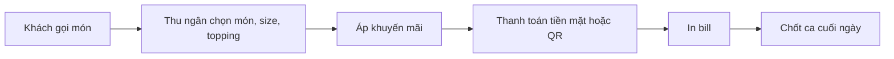

# Tổng quan nghiệp vụ — POS Quán Cafe

> Mô tả demo này cho ai, giải quyết vấn đề gì. Cập nhật khi phạm vi thay đổi.

---

## 1. Thông tin chung

| Mục | Nội dung |
| :--- | :--- |
| Tên demo | POS Quán Cafe |
| Mã dự án | `fnb-pos-cafe` |
| Ngành / loại khách hàng | Quán cafe, trà sữa 1–5 chi nhánh |
| Loại sản phẩm | Màn hình bán hàng trên tablet + web quản lý |
| Ý tưởng gốc | 1.1 · POS bán hàng quán cafe/trà sữa (`ZDOCS/02-KE-HOACH/DANH-SACH-Y-TUONG.md`) |
| Người phụ trách | Mạnh Hùng (Pum) |
| Trạng thái | Đã code BE + FE, chạy được cả hai chế độ (dữ liệu mẫu và BE thật trên Postgres) |

## 2. Vấn đề của khách hàng

- Ghi order bằng giấy dễ sai món, nhầm size, topping
- Cuối ca đối soát tiền mặt mất thời gian, hay lệch tiền
- Không biết món nào bán chạy, giờ nào đông khách
- Khuyến mãi, giảm giá tính tay

## 3. Giải pháp demo thể hiện

- Màn hình bán hàng chạm nhanh: món, size, topping, mức đường/đá, ghi chú
- Giảm giá theo món, theo hóa đơn, voucher
- Thanh toán tiền mặt hoặc chuyển khoản QR, in bill
- Mở ca, chốt ca, đối soát tiền mặt
- Báo cáo doanh thu theo giờ, món bán chạy

## 4. Vai trò người dùng

| Vai trò | Mã | Dùng trên | Làm được gì |
| :--- | :--- | :--- | :--- |
| Quản trị viên | ADMIN | Desktop | Toàn quyền |
| Quản lý quán | MANAGER | Desktop | Thực đơn, khuyến mãi, báo cáo, xem ca |
| Thu ngân | CASHIER | Tablet | Bán hàng, thanh toán, mở/chốt ca |

## 5. Phân hệ và chức năng

| Area | Chức năng | Màn hình (route FE dự kiến) | Ưu tiên |
| :--- | :--- | :--- | :---: |
| `System` | Đăng nhập, tài khoản, vai trò, cài đặt | Có sẵn | — |
| `Pos` | Thực đơn: danh mục, món, size, topping | `/menu-items` | P1 |
| `Pos` | Bán hàng tại quầy | `/pos` | P1 |
| `Pos` | Thanh toán, in bill | `/pos` (hộp thoại) | P1 |
| `Pos` | Tra cứu, in lại, hủy hóa đơn | `/orders` | P2 |
| `Pos` | Ca làm: mở, chốt, đối soát | `/shifts` | P1 |
| `Pos` | Tổng quan trong ngày | `/dashboard` | P1 |
| `Pos` | Khuyến mãi, voucher | `/promotions` | P2 |
| `Pos` | Báo cáo doanh thu, món bán chạy | `/reports` | P1 |
| `Crm` | Khách hàng tích điểm | `/customers` | P3 |

P1 = bắt buộc có để demo · P2 = nên có · P3 = làm thêm nếu còn thời gian.

## 6. Luồng nghiệp vụ chính

## 7. Phạm vi

**Có trong demo:**

- Bán hàng, thanh toán, in bill qua trình duyệt
- Ca làm và đối soát
- Báo cáo doanh thu

**Không làm (nói rõ với khách nếu được hỏi):**

- Kết nối máy in nhiệt thật (in qua trình duyệt)
- Hóa đơn điện tử thật, cổng thanh toán thật (QR giả lập)
- Các kết nối bên ngoài khác chỉ giả lập

## 8. Dữ liệu mẫu cần chuẩn bị

| Dữ liệu | Số lượng | Ghi chú |
| :--- | :---: | :--- |
| Danh mục món | 6 | Cà phê, trà sữa, trà trái cây, đá xay, soda và nước ép, bánh |
| Món | 40 | Có ảnh, 2–3 size |
| Topping | 12 |  |
| Hóa đơn | ~3.000 | Trải đều 90 ngày, đông giờ 7–9h và 14–16h |
| Ca làm | ~180 | 2 ca mỗi ngày, 90 ngày |
| Khuyến mãi | 5 | Đang chạy, sắp chạy, đã hết, tạm dừng |
| Voucher | 5 | `GIAM20K` còn lượt, `HETHAN` hết hạn, `HETLUOT` hết lượt |
| Khách tích điểm | 10 | P3 |
