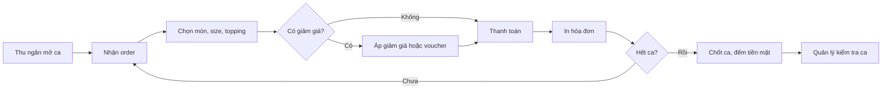
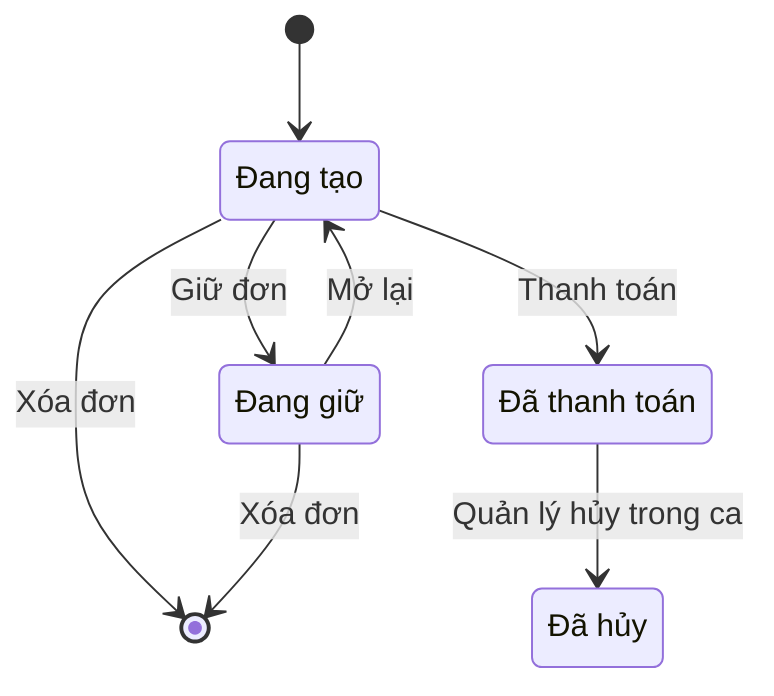
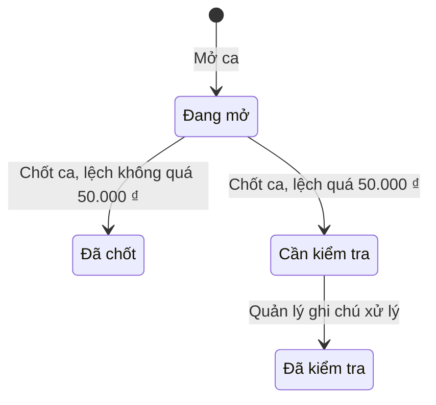

# Đặc tả yêu cầu phần mềm (SRS) — POS Quán Cafe

| Phiên bản | Ngày | Trạng thái |
| :--- | :--- | :--- |
| 1.0 | 12/10/2026 | Bản nháp để triển khai demo |

> Cách viết, quy ước mã, mức độ chi tiết: `ZDOCS/05-HUONG-DAN/HUONG-DAN-VIET-TAI-LIEU-NGHIEP-VU.md`.
> Phần nền (đăng nhập, tài khoản, vai trò, cài đặt, đặt lại dữ liệu demo): `ZDOCS/03-KIEN-TRUC/USE-CASE-NEN.md`, không viết lại ở đây.

---

## 1. Giới thiệu

### 1.1. Mục đích

Tài liệu mô tả đầy đủ yêu cầu của bản demo POS Quán Cafe: chức năng, quy tắc tính tiền, dữ liệu, báo cáo, phân quyền và màn hình. Dev dùng để code, tester dùng để viết và chạy test case, sales dùng để biết demo làm được gì.

### 1.2. Phạm vi

**Trong phạm vi:** thực đơn (danh mục, món, size, topping), bán hàng tại quầy, giảm giá và voucher, thanh toán tiền mặt và chuyển khoản QR, in hóa đơn qua trình duyệt, ca làm và đối soát tiền mặt, khuyến mãi, báo cáo, tích điểm khách hàng (P3).

**Ngoài phạm vi:** kết nối máy in nhiệt và két tiền thật, cổng thanh toán thật (QR chỉ hiển thị, thu ngân tự xác nhận), hóa đơn điện tử, quản lý kho nguyên liệu, nhiều chi nhánh, đặt món online.

### 1.3. Thuật ngữ

| Thuật ngữ | Giải thích |
| :--- | :--- |
| Món | Sản phẩm bán ra, vd "Trà sữa trân châu" |
| Size | Biến thể kích cỡ của món (S, M, L), mỗi size một giá |
| Topping | Thành phần thêm vào món, tính tiền riêng, vd trân châu, thạch |
| Tùy chọn | Mức đường, mức đá; không tính tiền |
| Đơn | Hóa đơn đang được tạo ở màn bán hàng, chưa thanh toán |
| Đơn giữ | Đơn lưu tạm để phục vụ khách khác, mở lại sau |
| Hóa đơn | Đơn đã thanh toán |
| Ca | Khoảng thời gian một thu ngân bán hàng, từ lúc mở ca đến lúc chốt ca |
| Tiền đầu ca | Tiền mặt có sẵn trong két khi mở ca |
| Tiền mặt lý thuyết | Số tiền mặt hệ thống tính được phải có trong két lúc chốt ca |
| Chênh lệch ca | Tiền mặt thực đếm trừ tiền mặt lý thuyết |
| Khuyến mãi | Chương trình giảm giá tự động theo điều kiện |
| Voucher | Mã giảm giá khách đưa, thu ngân nhập tay |
| Doanh thu thuần | Tổng tiền hàng trừ giảm giá, không tính hóa đơn hủy |

### 1.4. Tài liệu liên quan

| Tài liệu | Nội dung |
| :--- | :--- |
| `01-TONG-QUAN-NGHIEP-VU.md` | Tổng quan nghiệp vụ |
| `03-USE-CASE.md` | Đặc tả use case |
| `05-KICH-BAN-KIEM-THU.md` | Test case nghiệm thu |
| `ZDOCS/03-KIEN-TRUC/USE-CASE-NEN.md` | Phần nền dùng chung |

---

## 2. Mô tả tổng quan

### 2.1. Bối cảnh sản phẩm

Quán cafe, trà sữa quy mô 1–5 chi nhánh, mỗi quầy một tablet đặt cạnh máy in bill. Thu ngân nhận order, chọn món trên tablet, thu tiền và in bill. Quản lý theo dõi doanh thu, chỉnh thực đơn và khuyến mãi trên máy tính. Bản demo chạy một chi nhánh.

### 2.2. Tác nhân

| Mã vai trò | Tên | Thiết bị | Mục tiêu khi dùng hệ thống |
| :--- | :--- | :--- | :--- |
| `ADMIN` | Quản trị viên | Desktop | Cấu hình hệ thống, tài khoản, phân quyền |
| `MANAGER` | Quản lý quán | Desktop | Thực đơn, khuyến mãi, kiểm tra ca, xem báo cáo, duyệt giảm giá vượt mức |
| `CASHIER` | Thu ngân | Tablet ngang | Bán hàng nhanh, thu đúng tiền, chốt ca không lệch |

Tài khoản demo: `admin`, `quanly`, `thungan`. Vai trò `STAFF` của phần nền không dùng trong dự án này.

### 2.3. Quy trình nghiệp vụ

### 2.4. Giả định và ràng buộc

- Một chi nhánh, một quầy; mỗi thu ngân dùng một tài khoản riêng.
- Giá món và topping luôn là bội số của 1.000 ₫.
- In hóa đơn bằng lệnh in của trình duyệt, khổ 80 mm.
- QR chuyển khoản là ảnh giả lập theo định dạng VietQR; hệ thống không kiểm tra tiền đã về.
- Không quản lý tồn kho: món chỉ có trạng thái còn bán hoặc tạm hết.

---

## 3. Yêu cầu chức năng

### 3.1. Tổng quan

| Mã | Yêu cầu | Ưu tiên | Vai trò | UC |
| :--- | :--- | :---: | :--- | :--- |
| FR-01 | Hệ thống hiển thị doanh thu thuần hôm nay, số hóa đơn, giá trị trung bình một hóa đơn và mức tăng giảm so với cùng giờ hôm qua | P1 | MANAGER | UC-12 |
| FR-02 | Hệ thống hiển thị biểu đồ doanh thu theo giờ trong ngày và top 5 món bán chạy hôm nay | P1 | MANAGER | UC-12 |

### 3.2. Thực đơn

| Mã | Yêu cầu | Ưu tiên | Vai trò | UC |
| :--- | :--- | :---: | :--- | :--- |
| FR-03 | Hệ thống cho phép quản lý thêm, sửa, ẩn/hiện, sắp xếp thứ tự danh mục món | P1 | MANAGER | UC-01 |
| FR-04 | Hệ thống cho phép quản lý thêm, sửa, ẩn/hiện món với mã, tên, danh mục, ảnh, mô tả, giá theo từng size, danh sách topping được chọn, có hay không tùy chọn đường/đá | P1 | MANAGER | UC-01 |
| FR-05 | Hệ thống cho phép quản lý thêm, sửa, ẩn/hiện topping với tên và giá | P1 | MANAGER | UC-01 |
| FR-06 | Hệ thống cho phép đánh dấu món hoặc topping tạm hết và bán lại; món tạm hết hiển thị mờ, không chọn được ở màn bán hàng | P1 | MANAGER, CASHIER | UC-02 |

### 3.3. Bán hàng

| Mã | Yêu cầu | Ưu tiên | Vai trò | UC |
| :--- | :--- | :---: | :--- | :--- |
| FR-07 | Màn bán hàng hiển thị món dạng lưới có ảnh, lọc theo danh mục, tìm theo tên hoặc mã | P1 | CASHIER | UC-04 |
| FR-08 | Chạm vào món mở hộp tùy chọn gồm size, topping (chọn nhiều), mức đường, mức đá, ghi chú, số lượng; hiển thị thành tiền tạm tính | P1 | CASHIER | UC-04 |
| FR-09 | Giỏ hàng cho phép sửa số lượng, sửa tùy chọn, xóa dòng; tổng tiền cập nhật ngay | P1 | CASHIER | UC-04 |
| FR-10 | Thu ngân chọn hình thức phục vụ: tại chỗ (nhập số thẻ bàn) hoặc mang đi | P1 | CASHIER | UC-04 |
| FR-11 | Thu ngân giữ đơn đang tạo để phục vụ khách khác và mở lại đơn đang giữ | P2 | CASHIER | UC-05 |
| FR-12 | Thu ngân giảm giá theo dòng món hoặc toàn hóa đơn, theo phần trăm hoặc số tiền, có lý do | P1 | CASHIER | UC-06 |
| FR-13 | Thu ngân nhập mã voucher để giảm giá hóa đơn | P2 | CASHIER | UC-06 |
| FR-14 | Hệ thống tự áp khuyến mãi đang chạy khi đơn đủ điều kiện và hiển thị tên khuyến mãi trong giỏ | P2 | CASHIER | UC-06 |
| FR-15 | Giảm giá vượt hạn mức của thu ngân cần quản lý xác nhận bằng tài khoản quản lý ngay trên tablet | P1 | CASHIER, MANAGER | UC-06 |

### 3.4. Thanh toán và hóa đơn

| Mã | Yêu cầu | Ưu tiên | Vai trò | UC |
| :--- | :--- | :---: | :--- | :--- |
| FR-16 | Thanh toán tiền mặt: nhập tiền khách đưa, có nút mệnh giá nhanh (đủ tiền, 50.000, 100.000, 200.000, 500.000), hiển thị tiền thối | P1 | CASHIER | UC-07 |
| FR-17 | Thanh toán chuyển khoản: hiển thị mã QR có số tiền và nội dung là mã hóa đơn; thu ngân bấm "Đã nhận tiền" để hoàn tất | P1 | CASHIER | UC-07 |
| FR-18 | Sau khi thanh toán, hệ thống mở bản in hóa đơn khổ 80 mm gồm thông tin quán, mã hóa đơn, thời gian, thu ngân, món và tùy chọn, giảm giá, tổng tiền, phương thức, tiền khách đưa và tiền thối | P1 | CASHIER | UC-07 |
| FR-19 | Thu ngân và quản lý tra cứu hóa đơn theo mã, thời gian, phương thức, trạng thái; xem chi tiết và in lại | P2 | CASHIER, MANAGER | UC-09 |
| FR-20 | Quản lý hủy hóa đơn đã thanh toán trong ca đang mở, bắt buộc nhập lý do | P2 | MANAGER | UC-08 |

### 3.5. Ca làm

| Mã | Yêu cầu | Ưu tiên | Vai trò | UC |
| :--- | :--- | :---: | :--- | :--- |
| FR-21 | Thu ngân mở ca bằng cách nhập tiền đầu ca; màn bán hàng bị khóa khi chưa mở ca | P1 | CASHIER | UC-03 |
| FR-22 | Khi chốt ca, hệ thống tổng hợp số hóa đơn, số hóa đơn hủy, doanh thu theo phương thức, tiền mặt lý thuyết; thu ngân nhập tiền mặt thực đếm; hệ thống tính chênh lệch | P1 | CASHIER | UC-10 |
| FR-23 | Thu ngân in phiếu chốt ca | P2 | CASHIER | UC-10 |
| FR-24 | Quản lý xem danh sách ca theo ngày, lọc ca "Cần kiểm tra", xem chi tiết từng ca kèm danh sách hóa đơn | P1 | MANAGER | UC-11 |
| FR-25 | Quản lý ghi chú xử lý cho ca "Cần kiểm tra" và đánh dấu đã kiểm tra | P2 | MANAGER | UC-11 |

### 3.6. Khuyến mãi và voucher

| Mã | Yêu cầu | Ưu tiên | Vai trò | UC |
| :--- | :--- | :---: | :--- | :--- |
| FR-26 | Quản lý tạo, sửa, tạm dừng chương trình khuyến mãi: tên, kiểu giảm (phần trăm hoặc số tiền), phạm vi (hóa đơn, danh mục, món), giá trị đơn tối thiểu, khung giờ, ngày trong tuần, thời gian hiệu lực | P2 | MANAGER | UC-13 |
| FR-27 | Quản lý tạo, sửa, tạm dừng voucher: mã, kiểu và giá trị giảm, giảm tối đa, đơn tối thiểu, số lượt tối đa, hạn dùng; xem số lượt đã dùng | P2 | MANAGER | UC-13 |

### 3.7. Báo cáo

| Mã | Yêu cầu | Ưu tiên | Vai trò | UC |
| :--- | :--- | :---: | :--- | :--- |
| FR-28 | Báo cáo doanh thu theo ngày trong khoảng thời gian chọn, so sánh với kỳ liền trước cùng độ dài | P1 | MANAGER | UC-14 |
| FR-29 | Báo cáo món bán chạy: số lượng, doanh thu, tỉ trọng; lọc theo danh mục | P1 | MANAGER | UC-14 |
| FR-30 | Báo cáo theo khung giờ: bảng nhiệt doanh thu theo giờ và thứ trong tuần | P2 | MANAGER | UC-14 |
| FR-31 | Báo cáo theo phương thức thanh toán và theo thu ngân | P2 | MANAGER | UC-14 |
| FR-32 | Xuất báo cáo đang xem ra file Excel | P3 | MANAGER | UC-14 |

### 3.8. Khách hàng

| Mã | Yêu cầu | Ưu tiên | Vai trò | UC |
| :--- | :--- | :---: | :--- | :--- |
| FR-33 | Ở màn bán hàng, thu ngân tra khách theo số điện thoại hoặc thêm nhanh khách mới, gắn khách vào đơn | P3 | CASHIER | UC-15 |
| FR-34 | Hệ thống cộng điểm cho khách khi hóa đơn thanh toán; quản lý xem danh sách khách, điểm, lịch sử mua | P3 | CASHIER, MANAGER | UC-15 |

---

## 4. Quy tắc nghiệp vụ

| Mã | Quy tắc | Áp dụng cho |
| :--- | :--- | :--- |
| BR-01 | Thành tiền một dòng = (giá size + tổng giá topping đã chọn) × số lượng | FR-08, FR-09 |
| BR-02 | Tổng thanh toán = tổng thành tiền các dòng − giảm giá dòng − giảm giá hóa đơn; không nhỏ hơn 0 | FR-09, FR-12 |
| BR-03 | Giảm theo phần trăm làm tròn xuống tới bội số 1.000 ₫ | FR-12, FR-13, FR-14 |
| BR-04 | Thu ngân tự giảm tối đa 10% tổng tiền hàng của hóa đơn (cộng cả giảm dòng và giảm hóa đơn); vượt mức cần quản lý xác nhận | FR-12, FR-15 |
| BR-05 | Một hóa đơn dùng tối đa một voucher và một khuyến mãi cấp hóa đơn, không cộng dồn: khi cả hai cùng hợp lệ, hệ thống chọn mức giảm lớn hơn. Khuyến mãi cấp món cộng dồn được với voucher | FR-13, FR-14 |
| BR-06 | Voucher hợp lệ khi đang hoạt động, còn hạn, còn lượt, và tổng tiền hàng đạt giá trị đơn tối thiểu. Số lượt dùng chỉ tăng khi hóa đơn thanh toán thành công | FR-13, FR-27 |
| BR-07 | Khuyến mãi theo khung giờ xét theo thời điểm thanh toán, không theo thời điểm thêm món | FR-14, FR-26 |
| BR-08 | Thanh toán tiền mặt: tiền khách đưa phải lớn hơn hoặc bằng tổng thanh toán; tiền thối = tiền khách đưa − tổng thanh toán | FR-16 |
| BR-09 | Mã hóa đơn: `HD` + `yyMMdd` + số thứ tự 4 chữ số trong ngày, vd `HD2610120015` | FR-18 |
| BR-10 | Không tạo hóa đơn khi thu ngân chưa mở ca. Mỗi thu ngân chỉ có tối đa một ca đang mở | FR-21 |
| BR-11 | Tiền mặt lý thuyết = tiền đầu ca + tiền mặt thu trong ca − tiền mặt của hóa đơn bị hủy trong ca | FR-22 |
| BR-12 | Chênh lệch ca = tiền mặt thực đếm − tiền mặt lý thuyết. Trị tuyệt đối của chênh lệch lớn hơn 50.000 ₫ thì ca có trạng thái "Cần kiểm tra" | FR-22, FR-24 |
| BR-13 | Chỉ hủy được hóa đơn thuộc ca đang mở. Hóa đơn hủy không tính doanh thu, không cộng điểm, trả lại lượt voucher | FR-20 |
| BR-14 | Món hoặc topping tạm hết không thêm được vào đơn. Mở lại đơn giữ có món vừa tạm hết thì hệ thống cảnh báo và đánh dấu dòng đó | FR-06, FR-11 |
| BR-15 | Tối đa 10 đơn giữ cùng lúc mỗi thu ngân. Khi chốt ca còn đơn giữ, hệ thống yêu cầu xử lý (thanh toán hoặc xóa) trước | FR-11, FR-22 |
| BR-16 | Doanh thu thuần tính theo thời điểm thanh toán, không gồm hóa đơn hủy | FR-01, FR-28 |
| BR-17 | Tích điểm: 1 điểm cho mỗi 10.000 ₫ tổng thanh toán, làm tròn xuống | FR-34 |
| BR-18 | Món đã có trong hóa đơn thì không xóa được, chỉ ẩn | FR-04 |

---

## 5. Yêu cầu dữ liệu

### 5.1. Thực thể

| Thực thể | Mô tả | Thuộc tính chính | Quan hệ |
| :--- | :--- | :--- | :--- |
| Danh mục | Nhóm món trên màn bán hàng | Tên, thứ tự, hiển thị | Có nhiều món |
| Món | Sản phẩm bán ra | Mã, tên, ảnh, mô tả, có tùy chọn đường/đá, trạng thái (đang bán, tạm hết, ẩn) | Thuộc một danh mục; có nhiều size; gắn nhiều topping |
| Size món | Giá theo kích cỡ | Tên size (S, M, L), giá, mặc định | Thuộc một món |
| Topping | Thành phần thêm | Tên, giá, trạng thái | Gắn với nhiều món |
| Hóa đơn | Đơn bán hàng | Mã, thời gian tạo, thời gian thanh toán, hình thức phục vụ, số thẻ bàn, tổng tiền hàng, giảm giá, tổng thanh toán, trạng thái, lý do hủy | Thuộc một ca; do một thu ngân tạo; có nhiều dòng; có một thanh toán; có thể gắn voucher, khuyến mãi, khách hàng |
| Dòng hóa đơn | Một món trong hóa đơn | Tên món, size, giá size, mức đường, mức đá, ghi chú, số lượng, giảm giá dòng, thành tiền | Thuộc một hóa đơn; có nhiều topping kèm giá tại thời điểm bán |
| Thanh toán | Thông tin thu tiền | Phương thức (tiền mặt, chuyển khoản), số tiền, tiền khách đưa, tiền thối | Thuộc một hóa đơn |
| Ca | Ca bán hàng | Mã, thu ngân, giờ mở, giờ chốt, tiền đầu ca, tiền mặt lý thuyết, tiền thực đếm, chênh lệch, trạng thái, ghi chú | Có nhiều hóa đơn |
| Khuyến mãi | Giảm giá tự động | Tên, kiểu giảm, giá trị, phạm vi, đơn tối thiểu, khung giờ, ngày trong tuần, hiệu lực từ–đến, trạng thái | Áp cho danh mục hoặc món (nếu phạm vi là danh mục, món) |
| Voucher | Mã giảm giá | Mã, kiểu giảm, giá trị, giảm tối đa, đơn tối thiểu, số lượt tối đa, số lượt đã dùng, hạn dùng, trạng thái | Dùng trong nhiều hóa đơn |
| Khách hàng | Khách tích điểm (P3) | Số điện thoại, tên, điểm, ngày tạo | Có nhiều hóa đơn |

Dòng hóa đơn lưu lại tên món, giá size, giá topping tại thời điểm bán. Đổi giá sau này không làm thay đổi hóa đơn cũ.

### 5.2. Vòng đời

**Hóa đơn**

**Ca**

**Voucher:** Hoạt động → Hết lượt (đủ số lượt) hoặc Hết hạn (quá hạn dùng); quản lý chuyển qua lại giữa Hoạt động và Tạm dừng.

### 5.3. Mã chứng từ

| Chứng từ | Định dạng | Ví dụ |
| :--- | :--- | :--- |
| Hóa đơn | `HD` + `yyMMdd` + 4 số | `HD2610120015` |
| Ca | `CA` + `yyMMdd` + 2 số | `CA26101201` |
| Món | `M` + 3 số | `M001` |
| Voucher | 4–12 ký tự chữ in hoa và số | `GIAM20K` |

---

## 6. Báo cáo

| Báo cáo | Chỉ số | Bộ lọc | Vai trò |
| :--- | :--- | :--- | :--- |
| Tổng quan hôm nay | Doanh thu thuần, số hóa đơn, giá trị trung bình, so hôm qua, doanh thu theo giờ, top 5 món | — | MANAGER |
| Doanh thu theo ngày | Doanh thu thuần, số hóa đơn, giảm giá, so kỳ trước | Khoảng ngày | MANAGER |
| Món bán chạy | Số lượng, doanh thu, tỉ trọng | Khoảng ngày, danh mục | MANAGER |
| Khung giờ | Bảng nhiệt doanh thu giờ × thứ | Khoảng ngày | MANAGER |
| Phương thức thanh toán | Số tiền, số hóa đơn, tỉ trọng mỗi phương thức | Khoảng ngày | MANAGER |
| Theo thu ngân | Số ca, số hóa đơn, doanh thu, tổng chênh lệch | Khoảng ngày | MANAGER |
| Hóa đơn hủy | Danh sách hóa đơn hủy, người hủy, lý do | Khoảng ngày | MANAGER |

---

## 7. Phân quyền

> Quyền nền (`dashboard`, `users`, `roles`, `settings`, `audit-logs`) xem `USE-CASE-NEN.md` §7.

| Mã quyền | Mô tả | ADMIN | MANAGER | CASHIER |
| :--- | :--- | :---: | :---: | :---: |
| `menu-items.view` | Xem thực đơn | ✓ | ✓ | ✓ |
| `menu-items.create` / `update` / `delete` | Quản lý danh mục, món, topping | ✓ | ✓ | |
| `menu-items.availability` | Báo tạm hết, bán lại | ✓ | ✓ | ✓ |
| `orders.create` | Bán hàng, thanh toán | ✓ | ✓ | ✓ |
| `orders.view` | Tra cứu hóa đơn (thu ngân chỉ thấy hóa đơn trong ca của mình) | ✓ | ✓ | ✓ |
| `orders.discount` | Giảm giá trong hạn mức | ✓ | ✓ | ✓ |
| `orders.discount-override` | Xác nhận giảm giá vượt hạn mức | ✓ | ✓ | |
| `orders.reprint` | In lại hóa đơn | ✓ | ✓ | ✓ |
| `orders.cancel` | Hủy hóa đơn | ✓ | ✓ | |
| `shifts.operate` | Mở ca, chốt ca của mình | ✓ | ✓ | ✓ |
| `shifts.view` | Xem mọi ca | ✓ | ✓ | |
| `shifts.review` | Ghi chú xử lý ca cần kiểm tra | ✓ | ✓ | |
| `promotions.view` / `create` / `update` / `delete` | Quản lý khuyến mãi, voucher | ✓ | ✓ | |
| `reports.view` | Xem báo cáo, tổng quan | ✓ | ✓ | |
| `customers.view` / `create` | Tra cứu, thêm khách | ✓ | ✓ | ✓ |

---

## 8. Yêu cầu phi chức năng

> Yêu cầu chung (bảo mật JWT, phân quyền, tiếng Việt, chế độ dữ liệu mẫu) theo `ZDOCS/03-KIEN-TRUC/KIEN-TRUC-HE-THONG.md`. Ở đây chỉ ghi yêu cầu riêng của dự án.

| Mã | Yêu cầu |
| :--- | :--- |
| NFR-01 | Màn bán hàng tối ưu cho tablet ngang 1280×800; vùng chạm tối thiểu 44×44 px; không cần cuộn để thấy nút Thanh toán |
| NFR-02 | Thêm món vào giỏ phản hồi dưới 100 ms (tính tại máy, không chờ server); hoàn tất thanh toán dưới 2 giây |
| NFR-03 | Bán một đơn 3 món có size và topping cần không quá 12 lần chạm, tính cả thanh toán |
| NFR-04 | Hóa đơn in vừa khổ 80 mm, chữ tối thiểu 12 px, không tràn lề |
| NFR-05 | Mất kết nối khi đang bán (chế độ `api`): giỏ hàng giữ nguyên trên máy, báo lỗi rõ, cho thử lại, không tạo trùng hóa đơn |
| NFR-06 | Dữ liệu mẫu có ít nhất 90 ngày hóa đơn để báo cáo có xu hướng, giờ cao điểm 7–9h và 14–16h rõ rệt |

---

## 9. Danh sách màn hình

| Mã | Màn hình | Route | Vai trò | Thiết bị | UC |
| :--- | :--- | :--- | :--- | :--- | :--- |
| SCR-01 | Tổng quan | `/dashboard` | MANAGER | Desktop | UC-12 |
| SCR-02 | Bán hàng | `/pos` | CASHIER | Tablet | UC-02, UC-04, UC-05, UC-06 |
| SCR-03 | Hộp tùy chọn món | `/pos` (hộp thoại) | CASHIER | Tablet | UC-04 |
| SCR-04 | Hộp thanh toán | `/pos` (hộp thoại) | CASHIER | Tablet | UC-07 |
| SCR-05 | Bản in hóa đơn | `/pos/receipt/[id]` | CASHIER | Máy in 80 mm | UC-07, UC-09 |
| SCR-06 | Mở ca, chốt ca | `/shifts/current` | CASHIER | Tablet | UC-03, UC-10 |
| SCR-07 | Danh sách ca | `/shifts` | MANAGER | Desktop | UC-11 |
| SCR-08 | Danh sách hóa đơn | `/orders` | CASHIER, MANAGER | Tablet, desktop | UC-08, UC-09 |
| SCR-09 | Thực đơn (tab Món, Danh mục, Topping) | `/menu-items` | MANAGER | Desktop | UC-01, UC-02 |
| SCR-10 | Khuyến mãi và voucher | `/promotions` | MANAGER | Desktop | UC-13 |
| SCR-11 | Báo cáo | `/reports` | MANAGER | Desktop | UC-14 |
| SCR-12 | Khách hàng | `/customers` | MANAGER | Desktop | UC-15 |
