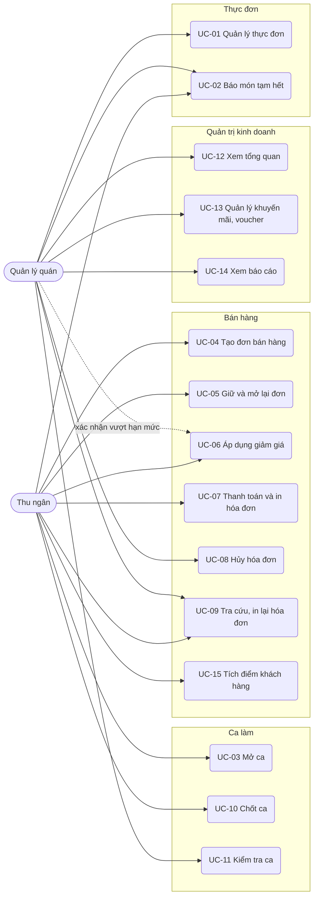
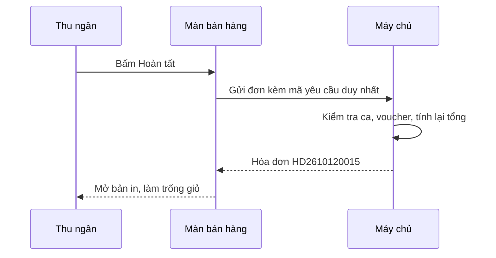

# Đặc tả use case — POS Quán Cafe

> Use case phần nền (UC-SYS-01 đến UC-SYS-10): `ZDOCS/03-KIEN-TRUC/USE-CASE-NEN.md`.
> Mã FR, BR, SCR tham chiếu `02-SRS.md`.

---

## 1. Tác nhân

| Tác nhân | Mã vai trò | Use case chính |
| :--- | :--- | :--- |
| Thu ngân | `CASHIER` | UC-02, UC-03, UC-04, UC-05, UC-06, UC-07, UC-09, UC-10, UC-15 |
| Quản lý quán | `MANAGER` | UC-01, UC-02, UC-06 (xác nhận), UC-08, UC-09, UC-11, UC-12, UC-13, UC-14 |
| Quản trị viên | `ADMIN` | Toàn bộ, cộng phần nền |

---

## 2. Sơ đồ use case

---

## 3. Danh sách use case

| Mã | Tên | Tác nhân chính | Module | Ưu tiên | FR |
| :--- | :--- | :--- | :--- | :---: | :--- |
| UC-01 | Quản lý thực đơn | Quản lý quán | Thực đơn | P1 | FR-03, FR-04, FR-05 |
| UC-02 | Báo món tạm hết | Thu ngân, Quản lý quán | Thực đơn | P1 | FR-06 |
| UC-03 | Mở ca | Thu ngân | Ca làm | P1 | FR-21 |
| UC-04 | Tạo đơn bán hàng | Thu ngân | Bán hàng | P1 | FR-07, FR-08, FR-09, FR-10 |
| UC-05 | Giữ và mở lại đơn | Thu ngân | Bán hàng | P2 | FR-11 |
| UC-06 | Áp dụng giảm giá | Thu ngân | Bán hàng | P1 | FR-12, FR-13, FR-14, FR-15 |
| UC-07 | Thanh toán và in hóa đơn | Thu ngân | Bán hàng | P1 | FR-16, FR-17, FR-18 |
| UC-08 | Hủy hóa đơn | Quản lý quán | Bán hàng | P2 | FR-20 |
| UC-09 | Tra cứu, in lại hóa đơn | Thu ngân, Quản lý quán | Bán hàng | P2 | FR-19 |
| UC-10 | Chốt ca | Thu ngân | Ca làm | P1 | FR-22, FR-23 |
| UC-11 | Kiểm tra ca | Quản lý quán | Ca làm | P1 | FR-24, FR-25 |
| UC-12 | Xem tổng quan | Quản lý quán | Quản trị kinh doanh | P1 | FR-01, FR-02 |
| UC-13 | Quản lý khuyến mãi, voucher | Quản lý quán | Quản trị kinh doanh | P2 | FR-26, FR-27 |
| UC-14 | Xem báo cáo | Quản lý quán | Quản trị kinh doanh | P1 | FR-28, FR-29, FR-30, FR-31, FR-32 |
| UC-15 | Tích điểm khách hàng | Thu ngân | Bán hàng | P3 | FR-33, FR-34 |

---

## 4. Đặc tả chi tiết

### UC-01: Quản lý thực đơn

| Mục | Nội dung |
| :--- | :--- |
| Tác nhân chính | Quản lý quán |
| Mô tả | Thêm, sửa, ẩn danh mục, món, topping và giá theo size |
| Ưu tiên | P1 |
| Điều kiện kích hoạt | Quán đổi món, đổi giá, thêm món mới |
| Tiền điều kiện | Có quyền `menu-items.create` hoặc `menu-items.update` |
| Hậu điều kiện | Màn bán hàng hiển thị thực đơn mới ngay ở lần tải kế tiếp |
| Yêu cầu liên quan | FR-03, FR-04, FR-05, BR-18 |
| Màn hình | SCR-09 |

**Luồng chính (thêm món)**

1. Quản lý mở Thực đơn, tab Món; hệ thống hiển thị danh sách món theo danh mục, có ảnh, giá thấp nhất, trạng thái.
2. Quản lý bấm "Thêm món".
3. Nhập mã, tên, chọn danh mục, tải ảnh, nhập mô tả.
4. Thêm các size: tên size và giá; đánh dấu một size mặc định.
5. Chọn các topping được phép thêm vào món; bật hoặc tắt tùy chọn đường/đá.
6. Bấm "Lưu"; hệ thống kiểm tra và lưu, món xuất hiện trong danh sách.

**Luồng thay thế**

- 1a. Quản lý danh mục: tab Danh mục, thêm hoặc đổi tên, kéo thả để sắp xếp, bật/tắt hiển thị.
- 1b. Quản lý topping: tab Topping, thêm hoặc sửa tên, giá.
- 1c. Sửa món: chọn món, đổi thông tin, lưu. Hóa đơn cũ giữ nguyên giá lúc bán.
- 1d. Ẩn món: bật "Ẩn"; món không còn ở màn bán hàng nhưng vẫn có trong báo cáo.

**Luồng ngoại lệ**

- E1. Mã món trùng: báo lỗi tại ô mã.
- E2. Chưa có size nào hoặc giá không phải bội số 1.000 ₫: báo lỗi, không lưu.
- E3. Xóa món đã từng bán: hệ thống từ chối, gợi ý dùng "Ẩn" (BR-18).

### UC-02: Báo món tạm hết

| Mục | Nội dung |
| :--- | :--- |
| Tác nhân chính | Thu ngân, Quản lý quán |
| Mô tả | Đánh dấu món hoặc topping tạm hết trong ngày và mở bán lại |
| Ưu tiên | P1 |
| Điều kiện kích hoạt | Hết nguyên liệu giữa ca |
| Tiền điều kiện | Có quyền `menu-items.availability` |
| Hậu điều kiện | Món tạm hết hiển thị mờ, không chọn được ở mọi máy bán hàng |
| Yêu cầu liên quan | FR-06, BR-14 |
| Màn hình | SCR-02, SCR-09 |

**Luồng chính**

1. Ở màn bán hàng, thu ngân nhấn giữ vào thẻ món.
2. Hệ thống hiện menu ngắn "Tạm hết".
3. Thu ngân chọn "Tạm hết"; thẻ món chuyển mờ, gắn nhãn "Tạm hết".

**Luồng thay thế**

- 1a. Bán lại: nhấn giữ vào món đang tạm hết, chọn "Bán lại".
- 1b. Topping tạm hết: trong hộp tùy chọn món, bấm biểu tượng bên cạnh topping, chọn "Tạm hết".
- 1c. Quản lý thao tác ở màn Thực đơn bằng công tắc "Còn bán".

**Luồng ngoại lệ**

- E1. Món đang nằm trong đơn giữ: hệ thống vẫn cho đánh dấu; khi mở lại đơn giữ thì cảnh báo (BR-14).

### UC-03: Mở ca

| Mục | Nội dung |
| :--- | :--- |
| Tác nhân chính | Thu ngân |
| Mô tả | Bắt đầu ca bán hàng và ghi nhận tiền đầu ca |
| Ưu tiên | P1 |
| Điều kiện kích hoạt | Thu ngân vào màn bán hàng khi chưa có ca đang mở |
| Tiền điều kiện | Có quyền `shifts.operate`; chưa có ca đang mở (BR-10) |
| Hậu điều kiện | Ca ở trạng thái "Đang mở", màn bán hàng mở khóa |
| Yêu cầu liên quan | FR-21, BR-10 |
| Màn hình | SCR-06 |

**Luồng chính**

1. Thu ngân mở màn bán hàng; hệ thống thấy chưa có ca, hiển thị hộp "Mở ca".
2. Thu ngân nhập tiền đầu ca (mặc định 1.000.000 ₫, sửa được).
3. Bấm "Mở ca"; hệ thống tạo ca với mã `CA` + ngày + số thứ tự, ghi giờ mở.
4. Màn bán hàng sẵn sàng.

**Luồng ngoại lệ**

- E1. Tiền đầu ca âm hoặc để trống: báo lỗi.
- E2. Thu ngân đã có ca đang mở ở máy khác: hệ thống mở tiếp ca đó, không tạo ca mới.

### UC-04: Tạo đơn bán hàng

| Mục | Nội dung |
| :--- | :--- |
| Tác nhân chính | Thu ngân |
| Mô tả | Ghi order của khách: món, size, topping, đường, đá, ghi chú |
| Ưu tiên | P1 |
| Điều kiện kích hoạt | Khách gọi món tại quầy |
| Tiền điều kiện | Ca đang mở |
| Hậu điều kiện | Đơn có ít nhất một dòng, sẵn sàng thanh toán |
| Yêu cầu liên quan | FR-07, FR-08, FR-09, FR-10, BR-01, BR-02, BR-14 |
| Màn hình | SCR-02, SCR-03 |

**Luồng chính**

1. Thu ngân chọn danh mục hoặc gõ tìm món.
2. Chạm vào thẻ món; hệ thống mở hộp tùy chọn với size mặc định đã chọn sẵn.
3. Thu ngân chọn size, topping, mức đường (0%, 30%, 50%, 70%, 100%), mức đá (không đá, ít, vừa, nhiều), nhập ghi chú nếu có, chỉnh số lượng.
4. Hệ thống hiển thị thành tiền tạm tính theo BR-01.
5. Bấm "Thêm vào đơn"; dòng xuất hiện trong giỏ, tổng tiền cập nhật.
6. Lặp lại bước 1–5 cho các món khác.
7. Chọn "Mang đi" hoặc "Tại chỗ" và nhập số thẻ bàn.

**Luồng thay thế**

- 2a. Món không có size, topping, tùy chọn: chạm một lần là thêm thẳng vào giỏ với số lượng 1.
- 5a. Món giống hệt dòng đã có (cùng size, topping, tùy chọn, ghi chú): hệ thống cộng số lượng vào dòng cũ.
- 6a. Sửa dòng: chạm vào dòng trong giỏ, mở lại hộp tùy chọn, sửa, lưu.
- 6b. Xóa dòng: vuốt dòng sang trái hoặc bấm biểu tượng xóa.
- 6c. Xóa cả đơn: bấm "Xóa đơn", xác nhận.

**Luồng ngoại lệ**

- E1. Món hoặc topping tạm hết: thẻ mờ, không mở được hộp tùy chọn (BR-14).
- E2. Chọn "Tại chỗ" mà không nhập số thẻ bàn: nút Thanh toán bị khóa, ô số thẻ bàn báo đỏ.

### UC-05: Giữ và mở lại đơn

| Mục | Nội dung |
| :--- | :--- |
| Tác nhân chính | Thu ngân |
| Mô tả | Lưu tạm đơn đang tạo để phục vụ khách khác |
| Ưu tiên | P2 |
| Yêu cầu liên quan | FR-11, BR-14, BR-15 |
| Màn hình | SCR-02 |

**Luồng chính**

1. Thu ngân bấm "Giữ đơn", nhập tên gợi nhớ (mặc định "Đơn 1", "Đơn 2"…).
2. Đơn chuyển vào danh sách đơn giữ, giỏ hàng trống.
3. Khi cần, thu ngân mở danh sách đơn giữ, chọn đơn; đơn trở lại giỏ để tiếp tục.

### UC-06: Áp dụng giảm giá

| Mục | Nội dung |
| :--- | :--- |
| Tác nhân chính | Thu ngân |
| Tác nhân phụ | Quản lý quán (xác nhận vượt hạn mức) |
| Mô tả | Giảm giá dòng hoặc hóa đơn, nhập voucher, áp khuyến mãi tự động |
| Ưu tiên | P1 |
| Điều kiện kích hoạt | Khách có voucher, khách quen, món lỗi cần bù |
| Tiền điều kiện | Đơn có ít nhất một dòng; có quyền `orders.discount` |
| Hậu điều kiện | Giảm giá ghi vào đơn kèm lý do và người duyệt (nếu có) |
| Yêu cầu liên quan | FR-12, FR-13, FR-14, FR-15, BR-02 đến BR-07 |
| Màn hình | SCR-02 |

**Luồng chính (giảm giá hóa đơn)**

1. Thu ngân bấm "Giảm giá" ở giỏ hàng.
2. Chọn kiểu: phần trăm hoặc số tiền; nhập giá trị; chọn lý do (Khách quen, Món lỗi, Khác kèm ghi chú).
3. Hệ thống tính số tiền giảm theo BR-03, kiểm tra hạn mức BR-04.
4. Trong hạn mức: áp ngay, giỏ hiển thị dòng "Giảm giá" và tổng mới.

**Luồng thay thế**

- 1a. Giảm theo dòng: chạm dòng món, chọn "Giảm giá dòng", tiếp tục bước 2.
- 1b. Voucher: bấm "Voucher", nhập mã; hệ thống kiểm tra BR-06, áp mức giảm, hiển thị tên voucher.
- 1c. Khuyến mãi tự động: khi giỏ thay đổi, hệ thống kiểm tra khuyến mãi đang chạy; đủ điều kiện thì tự thêm dòng giảm có tên khuyến mãi (BR-05, BR-07).
- 3a. Vượt hạn mức: hệ thống mở hộp "Quản lý xác nhận"; quản lý nhập tên đăng nhập, mật khẩu; tài khoản có quyền `orders.discount-override` thì áp giảm và ghi tên người duyệt.

**Luồng ngoại lệ**

- E1. Voucher không tồn tại, hết hạn, hết lượt hoặc đơn chưa đủ tối thiểu: báo lý do cụ thể, không áp.
- E2. Cả voucher và khuyến mãi hóa đơn cùng hợp lệ: hệ thống giữ mức giảm lớn hơn và thông báo cho thu ngân (BR-05).
- E3. Tài khoản xác nhận không có quyền hoặc sai mật khẩu: từ chối, giữ nguyên đơn.

### UC-07: Thanh toán và in hóa đơn

| Mục | Nội dung |
| :--- | :--- |
| Tác nhân chính | Thu ngân |
| Mô tả | Thu tiền mặt hoặc chuyển khoản, tạo hóa đơn, in bill |
| Ưu tiên | P1 |
| Điều kiện kích hoạt | Thu ngân bấm "Thanh toán" |
| Tiền điều kiện | Đơn hợp lệ (UC-04); ca đang mở |
| Hậu điều kiện | Hóa đơn "Đã thanh toán" có mã theo BR-09; giỏ trống; voucher tăng lượt dùng |
| Yêu cầu liên quan | FR-16, FR-17, FR-18, BR-06, BR-08, BR-09 |
| Màn hình | SCR-04, SCR-05 |

**Luồng chính (tiền mặt)**

1. Thu ngân bấm "Thanh toán"; hệ thống mở hộp thanh toán với tổng cần thu.
2. Chọn "Tiền mặt", bấm nút mệnh giá nhanh hoặc nhập tiền khách đưa.
3. Hệ thống hiển thị tiền thối theo BR-08.
4. Bấm "Hoàn tất"; hệ thống tạo hóa đơn, mở bản in hóa đơn.
5. Thu ngân in bill, đưa khách; màn bán hàng trở về giỏ trống.

**Luồng thay thế**

- 2a. Chuyển khoản: chọn "Chuyển khoản"; hệ thống hiển thị QR có số tiền, nội dung là mã hóa đơn dự kiến; khách quét và chuyển; thu ngân bấm "Đã nhận tiền"; tiếp tục bước 4.
- 4a. Không in: thu ngân tắt bản in; hóa đơn vẫn được lưu, in lại được ở UC-09.

**Luồng ngoại lệ**

- E1. Tiền khách đưa nhỏ hơn tổng: nút "Hoàn tất" bị khóa, hiện số tiền còn thiếu.
- E2. Mất kết nối khi bấm "Hoàn tất" (chế độ `api`): giỏ giữ nguyên, báo "Chưa lưu được hóa đơn, thử lại"; bấm lại không tạo trùng hóa đơn (NFR-05).

### UC-08: Hủy hóa đơn

| Mục | Nội dung |
| :--- | :--- |
| Tác nhân chính | Quản lý quán |
| Mô tả | Hủy hóa đơn thanh toán nhầm trong ca đang mở |
| Ưu tiên | P2 |
| Yêu cầu liên quan | FR-20, BR-11, BR-13 |
| Màn hình | SCR-08 |

**Luồng chính**

1. Quản lý mở Danh sách hóa đơn, chọn hóa đơn.
2. Bấm "Hủy hóa đơn", nhập lý do, xác nhận.
3. Hệ thống chuyển hóa đơn sang "Đã hủy", trừ khỏi doanh thu và tiền mặt lý thuyết của ca, trả lượt voucher.

### UC-09: Tra cứu, in lại hóa đơn

| Mục | Nội dung |
| :--- | :--- |
| Tác nhân chính | Thu ngân, Quản lý quán |
| Mô tả | Tìm hóa đơn đã bán, xem chi tiết, in lại |
| Ưu tiên | P2 |
| Yêu cầu liên quan | FR-19 |
| Màn hình | SCR-08, SCR-05 |

**Luồng chính**

1. Mở Danh sách hóa đơn; thu ngân thấy hóa đơn trong ca của mình, quản lý thấy tất cả.
2. Tìm theo mã hoặc lọc theo thời gian, phương thức, trạng thái.
3. Chọn hóa đơn để xem chi tiết, bấm "In lại"; bản in có dòng "IN LẠI".

### UC-10: Chốt ca

| Mục | Nội dung |
| :--- | :--- |
| Tác nhân chính | Thu ngân |
| Mô tả | Kết thúc ca, đối soát tiền mặt |
| Ưu tiên | P1 |
| Điều kiện kích hoạt | Hết giờ làm hoặc giao ca |
| Tiền điều kiện | Ca đang mở |
| Hậu điều kiện | Ca "Đã chốt" hoặc "Cần kiểm tra"; không bán được cho tới khi mở ca mới |
| Yêu cầu liên quan | FR-22, FR-23, BR-11, BR-12, BR-15 |
| Màn hình | SCR-06 |

**Luồng chính**

1. Thu ngân bấm "Chốt ca".
2. Hệ thống hiển thị tổng hợp: giờ mở, số hóa đơn, số hóa đơn hủy, doanh thu theo tiền mặt và chuyển khoản, tiền đầu ca, tiền mặt lý thuyết (BR-11).
3. Thu ngân đếm tiền trong két, nhập tiền mặt thực đếm (có bảng nhập theo mệnh giá để tự cộng).
4. Hệ thống tính chênh lệch (BR-12), hiển thị màu xanh nếu không quá 50.000 ₫, màu đỏ nếu quá.
5. Thu ngân nhập ghi chú nếu có, bấm "Xác nhận chốt ca".
6. Hệ thống lưu ca, mở bản in phiếu chốt ca, đăng xuất màn bán hàng về trạng thái chưa mở ca.

**Luồng thay thế**

- 1a. Còn đơn giữ: hệ thống liệt kê đơn giữ, yêu cầu thanh toán hoặc xóa trước khi chốt (BR-15).

**Luồng ngoại lệ**

- E1. Chênh lệch quá 50.000 ₫ mà không nhập ghi chú: hệ thống yêu cầu ghi chú trước khi xác nhận.

### UC-11: Kiểm tra ca

| Mục | Nội dung |
| :--- | :--- |
| Tác nhân chính | Quản lý quán |
| Mô tả | Xem các ca, phát hiện và xử lý ca lệch tiền |
| Ưu tiên | P1 |
| Tiền điều kiện | Có quyền `shifts.view` |
| Hậu điều kiện | Ca lệch được ghi chú xử lý, chuyển "Đã kiểm tra" |
| Yêu cầu liên quan | FR-24, FR-25, BR-12 |
| Màn hình | SCR-07 |

**Luồng chính**

1. Quản lý mở Danh sách ca; mặc định hiển thị 7 ngày gần nhất, ca "Cần kiểm tra" có nhãn đỏ.
2. Chọn một ca; hệ thống hiển thị tổng hợp như lúc chốt, danh sách hóa đơn của ca, hóa đơn hủy.
3. Với ca "Cần kiểm tra", quản lý nhập ghi chú xử lý, bấm "Đã kiểm tra".

**Luồng thay thế**

- 1a. Lọc theo thu ngân, theo trạng thái, theo khoảng ngày.

**Luồng ngoại lệ**

- E1. Ca đang mở: chỉ xem được số liệu tạm thời, không có nút "Đã kiểm tra".

### UC-12: Xem tổng quan

| Mục | Nội dung |
| :--- | :--- |
| Tác nhân chính | Quản lý quán |
| Mô tả | Nắm nhanh tình hình kinh doanh hôm nay |
| Ưu tiên | P1 |
| Tiền điều kiện | Có quyền `reports.view` |
| Hậu điều kiện | Không thay đổi dữ liệu |
| Yêu cầu liên quan | FR-01, FR-02, BR-16 |
| Màn hình | SCR-01 |

**Luồng chính**

1. Quản lý đăng nhập; hệ thống mở trang Tổng quan.
2. Hiển thị 4 thẻ số: doanh thu thuần, số hóa đơn, giá trị trung bình, mức tăng giảm so với cùng giờ hôm qua.
3. Hiển thị biểu đồ cột doanh thu theo giờ và bảng top 5 món bán chạy.

**Luồng thay thế**

- 3a. Bấm vào một món trong top 5: chuyển sang báo cáo món bán chạy, lọc sẵn món đó.

**Luồng ngoại lệ**

- E1. Hôm nay chưa có hóa đơn: các thẻ hiển thị 0, biểu đồ hiển thị trạng thái trống có hướng dẫn.

### UC-13: Quản lý khuyến mãi, voucher

| Mục | Nội dung |
| :--- | :--- |
| Tác nhân chính | Quản lý quán |
| Mô tả | Tạo và theo dõi chương trình khuyến mãi, voucher |
| Ưu tiên | P2 |
| Yêu cầu liên quan | FR-26, FR-27, BR-05, BR-06, BR-07 |
| Màn hình | SCR-10 |

**Luồng chính**

1. Quản lý mở Khuyến mãi; hệ thống hiển thị hai tab Khuyến mãi và Voucher, mỗi dòng có trạng thái (sắp chạy, đang chạy, đã hết, tạm dừng).
2. Bấm "Thêm", nhập thông tin theo FR-26 hoặc FR-27.
3. Lưu; khuyến mãi tự áp ở màn bán hàng khi tới thời gian hiệu lực, voucher dùng được ngay.

### UC-14: Xem báo cáo

| Mục | Nội dung |
| :--- | :--- |
| Tác nhân chính | Quản lý quán |
| Mô tả | Phân tích doanh thu, món, giờ cao điểm, phương thức, thu ngân |
| Ưu tiên | P1 |
| Tiền điều kiện | Có quyền `reports.view` |
| Hậu điều kiện | Không thay đổi dữ liệu |
| Yêu cầu liên quan | FR-28 đến FR-32, BR-16 |
| Màn hình | SCR-11 |

**Luồng chính**

1. Quản lý mở Báo cáo; mặc định tab Doanh thu, khoảng 30 ngày gần nhất.
2. Hệ thống hiển thị biểu đồ đường doanh thu theo ngày, đường kỳ trước làm nền, bảng số liệu bên dưới.
3. Quản lý đổi khoảng ngày (Hôm nay, 7 ngày, 30 ngày, Tháng này, Tháng trước, Tùy chọn); số liệu cập nhật.
4. Chuyển sang tab Món bán chạy, Khung giờ, Phương thức, Thu ngân, Hóa đơn hủy để xem các báo cáo khác.

**Luồng thay thế**

- 4a. Bấm "Xuất Excel": tải file của báo cáo đang xem (P3).

**Luồng ngoại lệ**

- E1. Khoảng ngày dài hơn 366 ngày: báo lỗi, yêu cầu chọn lại.
- E2. Khoảng ngày không có dữ liệu: hiển thị trạng thái trống.
