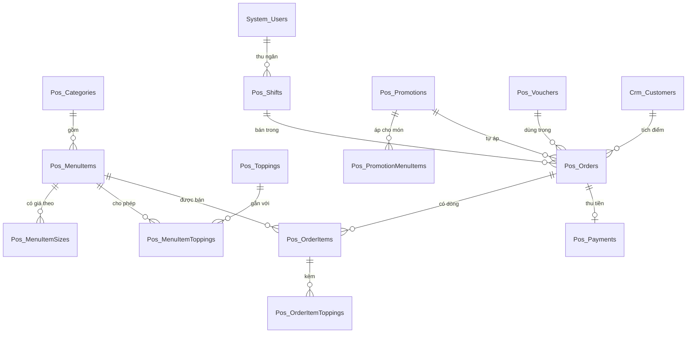

# Thiết kế CSDL — POS Quán Cafe

> Database: `WebDemo_FnbPosCafe`.
> Quy ước chung và nhóm bảng nền `System_*` (tài khoản, vai trò, quyền, cài đặt, nhật ký): xem `ZDOCS/03-KIEN-TRUC/THIET-KE-CSDL-NEN.md`.
> File này chỉ mô tả **bảng nghiệp vụ riêng của dự án**. Area: `Pos` (thực đơn, bán hàng, ca, khuyến mãi) và `Crm` (khách hàng, P3).
> Mã FR, BR, TC tham chiếu `02-SRS.md` và `05-KICH-BAN-KIEM-THU.md`. Hợp đồng API và công thức tính tiền: `07-DANH-SACH-API.md`.

---

## 1. Sơ đồ

---

## 2. Danh sách bảng

| Bảng | Area | Mô tả | Xóa | Dữ liệu mẫu |
| :--- | :--- | :--- | :--- | :---: |
| `Pos_Categories` | Pos | Danh mục món | Mềm, chặn khi còn món | 6 |
| `Pos_MenuItems` | Pos | Món | Mềm, chặn khi đã bán (BR-18) | 40 |
| `Pos_MenuItemSizes` | Pos | Giá theo size của món | Cứng, thay cả bộ khi sửa món | 78 |
| `Pos_Toppings` | Pos | Topping | Mềm, chặn khi đã bán | 12 |
| `Pos_MenuItemToppings` | Pos | Topping được phép của món (bảng nối) | Cứng | 191 |
| `Pos_Shifts` | Pos | Ca bán hàng | Không xóa | 179 |
| `Pos_Orders` | Pos | Hóa đơn và đơn giữ | Không xóa (đơn giữ xóa cứng) | 3.019 |
| `Pos_OrderItems` | Pos | Dòng hóa đơn (giá chụp lúc bán) | Theo hóa đơn | 5.694 |
| `Pos_OrderItemToppings` | Pos | Topping của dòng (giá chụp lúc bán) | Theo dòng | 1.882 |
| `Pos_Payments` | Pos | Thanh toán của hóa đơn (1–1) | Theo hóa đơn | 3.019 |
| `Pos_Promotions` | Pos | Khuyến mãi tự động | Mềm | 5 |
| `Pos_PromotionMenuItems` | Pos | Món thuộc khuyến mãi phạm vi món (bảng nối) | Cứng | 4 |
| `Pos_Vouchers` | Pos | Voucher | Mềm, chặn khi đã dùng | 5 |
| `Crm_Customers` | Crm | Khách tích điểm (P3) | Mềm | 10 |

Số hóa đơn, dòng, topping dòng là số do script sinh (`FE/scripts/generate-orders.mjs`, hạt giống cố định); số chính xác in ra khi chạy script, ghi lại ở §5.

---

## 3. Quy ước chung của dự án

- Mọi bảng có cột chung `Id`, `CreatedAt`, `CreatedBy`, `UpdatedAt`, `UpdatedBy` theo `THIET-KE-CSDL-NEN.md` §1; bảng xóa mềm có thêm `IsDeleted`. Bảng nối chỉ có khóa ghép.
- Tiền `numeric(18,2)`, luôn là bội số 1.000 ₫ ở dữ liệu nhập (giá, giảm số tiền) và kết quả làm tròn BR-03. Số lượng món `integer`.
- Thời gian lưu UTC; "ngày" trong mã chứng từ, báo cáo, ca làm tính theo giờ Việt Nam (`VietnamTime.Zone`).
- Enum lưu `int`, API trả chuỗi PascalCase không dấu (giá trị trong mục mô tả từng bảng). Tên enum C# và chuỗi API giống nhau để FE và BE dùng chung một bảng tra.
- Mã chứng từ sinh ở service trong transaction: `HD` + `yyMMdd` + 4 số thứ tự trong ngày (BR-09), `CA` + `yyMMdd` + 2 số thứ tự trong ngày. Trùng mã do hai request cùng lúc thì index unique báo lỗi và service thử lại một lần.
- Hóa đơn và ca **không bao giờ xóa**, kể cả xóa mềm; chỉ đổi trạng thái. Đặt lại dữ liệu demo xóa cứng toàn bộ bảng `Pos_*`, `Crm_*` (bảng con trước) rồi nạp lại.
- Cài đặt quán in trên bill và QR lưu ở `System_Settings` nhóm "Quán", khóa `Store.Name`, `Store.Address`, `Store.Phone`, `Store.ReceiptFooter`, `Store.BankBin`, `Store.BankAccount`, `Store.BankAccountName` (giá trị mẫu trong `FE/src/mock/seed/project.json`; đọc qua `GET /api/store-profile`, `07` §2.10). Hạn mức giảm giá 10% (BR-04), ngưỡng lệch ca 50.000 ₫ (BR-12), tối đa 10 đơn giữ (BR-15), 10.000 ₫ một điểm (BR-17) là hằng số trong code (`PosRules`), không phải cài đặt.
- Ảnh món mẫu: `/seed/menu/{maMon}.webp` (vd `/seed/menu/M001.webp`), FE phục vụ từ `FE/public/seed/menu/`; seed chỉ ghi tên file ở trường `image`, seeder và FE mock ghép thành đường dẫn. Ảnh tải lên qua giao diện lưu `/uploads/menu/{yyyy}/{MM}/{guid}.{ext}` theo `IFileStorage` nền. Món chưa có ảnh (`imageUrl` null) FE hiện ô màu theo danh mục kèm chữ viết tắt.

---

## 4. Mô tả bảng

### `Pos_Categories`: danh mục món

| Cột | Kiểu | Ràng buộc | Ghi chú |
| :--- | :--- | :--- | :--- |
| `Code` | `varchar(20)` | unique trong bản ghi chưa xóa | `CF`, `TS`… dùng để seed tham chiếu và làm màu ô ảnh mặc định |
| `Name` | `varchar(100)` | bắt buộc | |
| `Color` | `varchar(20)` | | Mã hex nhãn và nền ô ảnh mặc định |
| `SortOrder` | `integer` | | Thứ tự tab trên màn bán hàng; `PUT /api/categories/order` đánh lại 10, 20, 30… |
| `IsHidden` | `boolean` | mặc định 0 | Ẩn thì không hiện trên màn bán hàng, món bên trong vẫn tìm được theo mã |
| `IsDeleted` | `boolean` | mặc định 0 | Chỉ xóa được khi không còn món (kể cả món đã ẩn) |

### `Pos_MenuItems`: món

| Cột | Kiểu | Ràng buộc | Ghi chú |
| :--- | :--- | :--- | :--- |
| `Code` | `varchar(20)` | unique trong bản ghi chưa xóa | `M` + 3 số (SRS §5.3); trùng → 409 `errors.code` (TC-02) |
| `Name` | `varchar(150)` | bắt buộc | |
| `CategoryId` | `uuid` | FK `Pos_Categories`, chặn xóa | |
| `ImageUrl` | `varchar(500)` | | `/seed/menu/M001.webp` hoặc `/uploads/menu/...` |
| `Description` | `varchar(500)` | | |
| `HasSugarOption` | `boolean` | mặc định 1 | Có chọn mức đường (0, 30, 50, 70, 100) |
| `HasIceOption` | `boolean` | mặc định 1 | Có chọn mức đá |
| `IsSoldOut` | `boolean` | mặc định 0 | Tạm hết (FR-06), thu ngân đổi được |
| `IsHidden` | `boolean` | mặc định 0 | Ẩn khỏi màn bán hàng (FR-04), chỉ quản lý đổi |
| `SortOrder` | `integer` | | Thứ tự trong danh mục |
| `IsDeleted` | `boolean` | mặc định 0 | Xóa mềm; từ chối khi đã có trong `Pos_OrderItems` (BR-18, TC-03) |

Trạng thái hiển thị `status` trong DTO suy ra từ hai cờ: `An` khi `IsHidden`, `TamHet` khi `IsSoldOut`, còn lại `DangBan`. Hai cờ tách riêng để ẩn một món đang tạm hết rồi hiện lại vẫn giữ trạng thái tạm hết.

Index: `(CategoryId, SortOrder)`; unique `Code` lọc chưa xóa.

### `Pos_MenuItemSizes`: giá theo size

| Cột | Kiểu | Ràng buộc | Ghi chú |
| :--- | :--- | :--- | :--- |
| `MenuItemId` | `uuid` | FK, xóa theo món | |
| `Name` | `varchar(20)` | unique cùng `MenuItemId` | `S`, `M`, `L`; món một cỡ (bánh) dùng `Phần` |
| `Price` | `numeric(18,2)` | bội số 1.000, > 0 | Sai → 400 `errors.sizes[i].price` (UC-01 E2) |
| `IsDefault` | `boolean` | | Đúng một size mặc định mỗi món; thiếu thì size đầu tiên |
| `SortOrder` | `integer` | | |

Sửa món thì thay cả bộ size (xóa cứng dòng cũ không còn trong request). Dòng hóa đơn đã chụp `SizeName`, `SizePrice` nên không phụ thuộc bảng này.

### `Pos_Toppings`: topping

| Cột | Kiểu | Ràng buộc | Ghi chú |
| :--- | :--- | :--- | :--- |
| `Code` | `varchar(20)` | unique trong bản ghi chưa xóa | `TP01`… để seed tham chiếu |
| `Name` | `varchar(100)` | bắt buộc | |
| `Price` | `numeric(18,2)` | bội số 1.000, ≥ 0 | |
| `IsSoldOut` | `boolean` | mặc định 0 | Tạm hết áp cho mọi món (TC-04) |
| `IsHidden` | `boolean` | mặc định 0 | |
| `SortOrder` | `integer` | | |
| `IsDeleted` | `boolean` | mặc định 0 | Từ chối xóa khi đã có trong `Pos_OrderItemToppings` |

### `Pos_MenuItemToppings`: topping được phép của món

Khóa ghép (`MenuItemId`, `ToppingId`), cả hai FK xóa theo. Hộp tùy chọn chỉ hiện topping trong bảng này, bỏ topping đã ẩn, topping tạm hết hiện mờ.

### `Pos_Shifts`: ca bán hàng

| Cột | Kiểu | Ràng buộc | Ghi chú |
| :--- | :--- | :--- | :--- |
| `Code` | `varchar(20)` | unique | `CA` + `yyMMdd` + 2 số thứ tự ca mở trong ngày (mọi thu ngân) |
| `CashierId` | `uuid` | FK `System_Users`, có index | |
| `CashierName` | `varchar(150)` | | Chụp tên lúc mở ca để báo cáo không phụ thuộc tài khoản |
| `OpenedAt` | `timestamptz` | bắt buộc | |
| `ClosedAt` | `timestamptz` | null | |
| `OpeningCash` | `numeric(18,2)` | ≥ 0 | Tiền đầu ca |
| `OrderCount` | `integer` | | Số hóa đơn đã thanh toán (không gồm hủy), ghi lúc chốt |
| `CancelledOrderCount` | `integer` | | Ghi lúc chốt |
| `CashSales` | `numeric(18,2)` | | Tiền mặt của hóa đơn `DaThanhToan` trong ca, ghi lúc chốt |
| `TransferSales` | `numeric(18,2)` | | Chuyển khoản của hóa đơn `DaThanhToan`, ghi lúc chốt |
| `CashCancelled` | `numeric(18,2)` | | Tiền mặt của hóa đơn hủy trong ca (thông tin), ghi lúc chốt |
| `ExpectedCash` | `numeric(18,2)` | null | BR-11, ghi lúc chốt |
| `CountedCash` | `numeric(18,2)` | null | Tiền mặt thực đếm |
| `Difference` | `numeric(18,2)` | null | BR-12 = `CountedCash − ExpectedCash` |
| `Note` | `varchar(1000)` | | Ghi chú thu ngân khi chốt; bắt buộc khi lệch quá 50.000 ₫ (UC-10 E1) |
| `Status` | `integer` | | Enum `ShiftStatus` |
| `ReviewNote` | `varchar(1000)` | | Ghi chú xử lý của quản lý (FR-25) |
| `ReviewedById` | `uuid` | null | |
| `ReviewedByName` | `varchar(150)` | | |
| `ReviewedAt` | `timestamptz` | null | |

Enum `ShiftStatus`:

| Giá trị | Tên | Hiển thị | Ghi chú |
| :---: | :--- | :--- | :--- |
| 0 | `DangMo` | Đang mở | Mỗi thu ngân tối đa một ca `DangMo` (BR-10, service kiểm tra trước khi tạo) |
| 1 | `DaChot` | Đã chốt | Lệch không quá 50.000 ₫ |
| 2 | `CanKiemTra` | Cần kiểm tra | Lệch quá 50.000 ₫ |
| 3 | `DaKiemTra` | Đã kiểm tra | Quản lý đã ghi chú xử lý |

Số tổng hợp khi ca còn mở tính trực tiếp từ `Pos_Orders` (API `GET /api/shifts/current/summary`); khi chốt mới ghi vào cột để danh sách ca và báo cáo thu ngân đọc nhanh. Index: `(CashierId, Status)`, `OpenedAt`.

### `Pos_Orders`: hóa đơn và đơn giữ

| Cột | Kiểu | Ràng buộc | Ghi chú |
| :--- | :--- | :--- | :--- |
| `Code` | `varchar(20)` | unique khi khác null | `HD` + `yyMMdd` + 4 số thứ tự thanh toán trong ngày (BR-09). Đơn giữ chưa có mã |
| `ClientRequestId` | `varchar(64)` | unique khi khác null | Mã yêu cầu FE sinh một lần cho mỗi lần thanh toán; gửi lại cùng mã thì trả hóa đơn cũ (TC-24, NFR-05) |
| `ShiftId` | `uuid` | FK `Pos_Shifts`, có index | Ca lúc tạo |
| `CashierId` | `uuid` | FK `System_Users` | |
| `CashierName` | `varchar(150)` | | Chụp lúc thanh toán, in trên bill |
| `Status` | `integer` | | Enum `OrderStatus` |
| `HoldName` | `varchar(50)` | | Tên gợi nhớ đơn giữ ("Đơn 1", "Chị áo đỏ") |
| `ServiceType` | `integer` | | Enum `ServiceType` |
| `TableTag` | `varchar(10)` | | Số thẻ bàn, bắt buộc khi `TaiCho` (TC-15) |
| `Subtotal` | `numeric(18,2)` | | Tổng tiền hàng = Σ `LineTotal` (trước mọi giảm giá) |
| `LineDiscountTotal` | `numeric(18,2)` | | Σ giảm giá dòng thủ công |
| `ItemPromotionDiscount` | `numeric(18,2)` | | Σ khuyến mãi cấp món (phạm vi danh mục, món) |
| `OrderDiscountType` | `integer` | null | Enum `DiscountType` của giảm giá hóa đơn thủ công |
| `OrderDiscountValue` | `numeric(18,2)` | null | Phần trăm hoặc số tiền nhập |
| `OrderDiscountAmount` | `numeric(18,2)` | | Số tiền giảm hóa đơn thủ công sau BR-03 |
| `OrderDiscountReason` | `varchar(200)` | | "Khách quen", "Món lỗi", "Khác: …" |
| `DiscountApprovedById` | `uuid` | null | Người duyệt giảm vượt hạn mức (FR-15) |
| `DiscountApprovedByName` | `varchar(50)` | | Tên đăng nhập người duyệt, vd `quanly` (TC-17) |
| `PromotionId` | `uuid` | null, FK `Pos_Promotions` | Khuyến mãi cấp hóa đơn đã áp |
| `PromotionName` | `varchar(150)` | | Chụp tên |
| `PromotionDiscount` | `numeric(18,2)` | | Số tiền khuyến mãi cấp hóa đơn |
| `VoucherId` | `uuid` | null, FK `Pos_Vouchers` | |
| `VoucherCode` | `varchar(12)` | | Chụp mã |
| `VoucherDiscount` | `numeric(18,2)` | | |
| `DiscountTotal` | `numeric(18,2)` | | = `LineDiscountTotal + ItemPromotionDiscount + OrderDiscountAmount + PromotionDiscount + VoucherDiscount` |
| `Total` | `numeric(18,2)` | ≥ 0 | Tổng thanh toán (BR-02) |
| `CustomerId` | `uuid` | null, FK `Crm_Customers` | |
| `CustomerPhone` | `varchar(20)` | | Chụp SĐT |
| `PointsEarned` | `integer` | | BR-17, 0 với đơn hủy |
| `PaidAt` | `timestamptz` | null | Thời điểm thanh toán; doanh thu, khuyến mãi khung giờ xét theo cột này (BR-07, BR-16) |
| `CancelledAt` | `timestamptz` | null | |
| `CancelledById` | `uuid` | null | |
| `CancelledByName` | `varchar(50)` | | |
| `CancelReason` | `varchar(200)` | | Bắt buộc khi hủy (FR-20) |

Enum `OrderStatus` (trạng thái "Đang tạo" của SRS §5.2 chỉ tồn tại trong giỏ hàng trên FE, không lưu DB):

| Giá trị | Tên | Hiển thị |
| :---: | :--- | :--- |
| 0 | `DangGiu` | Đang giữ |
| 1 | `DaThanhToan` | Đã thanh toán |
| 2 | `DaHuy` | Đã hủy |

Enum `ServiceType`: `0 MangDi` Mang đi, `1 TaiCho` Tại chỗ. Enum `DiscountType`: `0 PhanTram`, `1 SoTien`.

Index: `(ShiftId)`, `(Status, PaidAt)`, `(CashierId, PaidAt)`, `(CustomerId)`; unique lọc khác null cho `Code` và `ClientRequestId`. Đơn giữ (`DangGiu`) xóa cứng khi thu ngân bỏ hoặc khi thanh toán với `heldOrderId` thì chính dòng đó chuyển sang `DaThanhToan` và được gán mã.

### `Pos_OrderItems`: dòng hóa đơn

| Cột | Kiểu | Ràng buộc | Ghi chú |
| :--- | :--- | :--- | :--- |
| `OrderId` | `uuid` | FK, xóa theo hóa đơn | |
| `MenuItemId` | `uuid` | FK `Pos_MenuItems`, chặn xóa | Để BR-18 và báo cáo món |
| `ItemCode` | `varchar(20)` | | Chụp mã |
| `ItemName` | `varchar(150)` | | Chụp tên lúc bán |
| `CategoryId` | `uuid` | | Chụp để báo cáo lọc theo danh mục; không FK |
| `SizeName` | `varchar(20)` | | |
| `SizePrice` | `numeric(18,2)` | | Giá size lúc bán |
| `SugarLevel` | `integer` | null | 0, 30, 50, 70, 100 (phần trăm); null khi món không có tùy chọn |
| `IceLevel` | `integer` | null | Enum `IceLevel` |
| `Note` | `varchar(200)` | | |
| `Quantity` | `integer` | 1–99 | |
| `UnitPrice` | `numeric(18,2)` | | = `SizePrice` + Σ giá topping |
| `LineTotal` | `numeric(18,2)` | | = `UnitPrice × Quantity` (BR-01) |
| `DiscountType` | `integer` | null | Giảm giá dòng thủ công |
| `DiscountValue` | `numeric(18,2)` | null | |
| `DiscountAmount` | `numeric(18,2)` | | Sau BR-03 |
| `DiscountReason` | `varchar(200)` | | |
| `PromotionId` | `uuid` | null | Khuyến mãi cấp món đã áp cho dòng |
| `PromotionName` | `varchar(150)` | | Chụp tên khuyến mãi cấp món để bill, `OrderItemDto.promotion.name` không phụ thuộc bảng khuyến mãi |
| `PromotionDiscount` | `numeric(18,2)` | | |
| `SortOrder` | `integer` | | Thứ tự trong giỏ |

Enum `IceLevel`: `0 KhongDa` Không đá, `1 It` Ít đá, `2 Vua` Vừa, `3 Nhieu` Nhiều đá.

### `Pos_OrderItemToppings`: topping của dòng

| Cột | Kiểu | Ghi chú |
| :--- | :--- | :--- |
| `OrderItemId` | `uuid` | FK, xóa theo dòng |
| `ToppingId` | `uuid` | FK `Pos_Toppings`, chặn xóa |
| `ToppingName` | `varchar(100)` | Chụp tên |
| `Price` | `numeric(18,2)` | Giá lúc bán |

### `Pos_Payments`: thanh toán

| Cột | Kiểu | Ràng buộc | Ghi chú |
| :--- | :--- | :--- | :--- |
| `OrderId` | `uuid` | FK, unique | Một hóa đơn một thanh toán; đơn giữ chưa có |
| `Method` | `integer` | | Enum `PaymentMethod` |
| `Amount` | `numeric(18,2)` | | = `Total` của hóa đơn |
| `CashReceived` | `numeric(18,2)` | null | Chỉ tiền mặt, ≥ `Amount` (BR-08) |
| `ChangeAmount` | `numeric(18,2)` | null | = `CashReceived − Amount` |
| `QrContent` | `varchar(300)` | | Chuỗi QR đã hiển thị (chuyển khoản), để in lại giống lúc bán |
| `PaidAt` | `timestamptz` | | Trùng `Pos_Orders.PaidAt` |

Enum `PaymentMethod`: `0 TienMat` Tiền mặt, `1 ChuyenKhoan` Chuyển khoản.

### `Pos_Promotions`: khuyến mãi tự động

| Cột | Kiểu | Ràng buộc | Ghi chú |
| :--- | :--- | :--- | :--- |
| `Code` | `varchar(20)` | unique trong bản ghi chưa xóa | `KM01`… để seed tham chiếu; FE không bắt nhập, BE tự sinh `KM` + 2 số khi tạo qua API |
| `Name` | `varchar(150)` | bắt buộc | Hiện trong giỏ và trên bill |
| `Description` | `varchar(500)` | | |
| `DiscountType` | `integer` | | Enum `DiscountType` |
| `DiscountValue` | `numeric(18,2)` | > 0 | Phần trăm 1–100 hoặc số tiền bội số 1.000 |
| `MaxDiscount` | `numeric(18,2)` | null | Giảm tối đa mỗi hóa đơn (chỉ phần trăm) |
| `Scope` | `integer` | | Enum `PromotionScope` |
| `CategoryId` | `uuid` | null, FK | Bắt buộc khi `Scope = DanhMuc` |
| `MinOrderAmount` | `numeric(18,2)` | | Tổng tiền hàng tối thiểu, 0 là không xét |
| `StartTime` | `time` | null | Khung giờ từ (giờ Việt Nam), null là cả ngày |
| `EndTime` | `time` | null | Khung giờ đến, không gồm phút cuối (`14:00`–`16:00` áp cho 14:00:00–15:59:59) |
| `DaysOfWeek` | `varchar(20)` | | Chuỗi số cách nhau dấu phẩy, 1 = Thứ Hai … 7 = Chủ nhật; rỗng là mọi ngày |
| `StartDate` | `timestamptz` | | Hiệu lực từ 00:00 ngày này (giờ Việt Nam) |
| `EndDate` | `timestamptz` | | Hiệu lực hết 23:59:59 ngày này |
| `IsPaused` | `boolean` | mặc định 0 | Tạm dừng |
| `IsDeleted` | `boolean` | mặc định 0 | |

Enum `PromotionScope`: `0 HoaDon` cả hóa đơn, `1 DanhMuc` món thuộc danh mục, `2 Mon` món trong `Pos_PromotionMenuItems`.

Trạng thái `status` trong DTO suy ra: `TamDung` khi `IsPaused`; `SapChay` khi hôm nay < `StartDate`; `DaHet` khi hôm nay > `EndDate`; còn lại `DangChay`. Khuyến mãi phạm vi `HoaDon` giảm trên hóa đơn và không cộng dồn với voucher (BR-05); phạm vi `DanhMuc`, `Mon` giảm trên từng dòng thuộc phạm vi và cộng dồn được với voucher. Công thức ở `07-DANH-SACH-API.md` §3.

### `Pos_PromotionMenuItems`: món của khuyến mãi phạm vi món

Khóa ghép (`PromotionId`, `MenuItemId`), xóa theo khuyến mãi; FK món chặn xóa.

### `Pos_Vouchers`: voucher

| Cột | Kiểu | Ràng buộc | Ghi chú |
| :--- | :--- | :--- | :--- |
| `Code` | `varchar(12)` | unique trong bản ghi chưa xóa, 4–12 ký tự `A–Z0–9` | Lưu chữ in hoa; nhập thường vẫn khớp (service chuẩn hóa) |
| `Description` | `varchar(200)` | | |
| `DiscountType` | `integer` | | Enum `DiscountType` |
| `DiscountValue` | `numeric(18,2)` | > 0 | |
| `MaxDiscount` | `numeric(18,2)` | null | Chỉ phần trăm |
| `MinOrderAmount` | `numeric(18,2)` | | Tổng tiền hàng tối thiểu (BR-06) |
| `MaxUses` | `integer` | null | Null là không giới hạn |
| `UsedCount` | `integer` | mặc định 0 | Tăng khi thanh toán, giảm khi hủy hóa đơn (BR-06, BR-13); seeder đếm từ hóa đơn mẫu |
| `ExpiresAt` | `timestamptz` | null | Hết hạn sau thời điểm này; null là không hạn |
| `IsPaused` | `boolean` | mặc định 0 | |
| `IsDeleted` | `boolean` | mặc định 0 | Từ chối xóa khi `UsedCount > 0`, gợi ý tạm dừng |

Trạng thái `status` trong DTO: `TamDung` khi `IsPaused`; `HetHan` khi quá `ExpiresAt`; `HetLuot` khi `UsedCount ≥ MaxUses`; còn lại `HoatDong`. Thứ tự kiểm tra khi thu ngân nhập mã và câu báo lỗi: `07-DANH-SACH-API.md` §2.7.

### `Crm_Customers`: khách tích điểm (P3)

| Cột | Kiểu | Ràng buộc | Ghi chú |
| :--- | :--- | :--- | :--- |
| `Phone` | `varchar(20)` | unique trong bản ghi chưa xóa | Lưu 10 số liền, hiển thị `0xxx xxx xxx` |
| `Name` | `varchar(150)` | bắt buộc | |
| `Points` | `integer` | mặc định 0 | Σ `PointsEarned` của hóa đơn `DaThanhToan`; hủy hóa đơn trừ lại (BR-13, BR-17) |
| `OrderCount` | `integer` | | Số hóa đơn `DaThanhToan` |
| `TotalSpent` | `numeric(18,2)` | | Σ `Total` của hóa đơn `DaThanhToan` |
| `LastOrderAt` | `timestamptz` | null | |
| `Note` | `varchar(500)` | | |
| `IsDeleted` | `boolean` | mặc định 0 | |

Ba cột tổng hợp (`Points`, `OrderCount`, `TotalSpent`, `LastOrderAt`) cập nhật ngay khi thanh toán và khi hủy; seeder tính từ hóa đơn mẫu.

---

## 5. Dữ liệu mẫu

Nguồn duy nhất: `FE/src/mock/seed/demo-data.json` (FE mock nạp trực tiếp, BE nhúng làm EmbeddedResource `Seed.demo-data.json`, đọc bằng `SeedJson.Read<PosSeedFile>("demo-data.json", timeProvider)`). Phần thực đơn, khuyến mãi, voucher, khách hàng viết tay; phần `shifts`, `orders` do `FE/scripts/generate-orders.mjs` sinh (chạy `pnpm seed:orders`, hạt giống cố định, chạy lại cho đúng kết quả cũ; script ghi đè hai mảng này và giữ nguyên phần viết tay).

Quán mẫu: **Mộc Cafe**, một chi nhánh, bán 06:30–21:30. Thu ngân mẫu: `thungan` (ca sáng là chính), `thungan2` (ca chiều là chính, không có nút Đăng nhập nhanh). Quản lý `quanly` là người hủy hóa đơn, duyệt giảm giá vượt mức và kiểm tra ca trong dữ liệu mẫu.

### 5.1. Số lượng

| Dữ liệu | Số lượng | Đặc điểm |
| :--- | :---: | :--- |
| Danh mục | 6 | Cà phê, Trà sữa, Trà trái cây, Đá xay, Soda và nước ép, Bánh |
| Món | 40 | Mã `M001`–`M040`; đồ uống 2–3 size, bánh 1 size `Phần`; `M099` để trống cho TC-01 |
| Size | 78 | Đồ uống 2–3 size, bánh 1 size |
| Topping | 12 | `TP01`–`TP12`; "Trân châu" 5.000 ₫ (`TP01`), "Thạch dừa" 7.000 ₫ (`TP04`) |
| Gán topping cho món | 191 | Trà sữa đủ 12; cà phê, trà trái cây, đá xay, soda một phần; bánh không có |
| Khuyến mãi | 5 | 2 đang chạy (`KM01` trà sữa 14–16h, `KM02` sáng T2–T6), 1 sắp chạy, 1 đã hết (`KM03`, hiệu lực 120–91 ngày trước, nằm ngoài khoảng 90 ngày hóa đơn mẫu nên không áp cho hóa đơn nào), 1 tạm dừng |
| Voucher | 5 | `GIAM20K` (20.000 ₫, đơn tối thiểu 60.000 ₫, 100 lượt, còn lượt), `HETHAN` (hết hạn 10 ngày trước), `TANGBAN`, `SINHNHAT`, `HETLUOT` (5 lượt, đã dùng hết) |
| Khách hàng | 10 | Điểm, số đơn, tổng chi tính từ hóa đơn mẫu |
| Ca | 179 | 90 ngày × 2 ca (sáng 06:3x–14:0x, chiều 13:5x–21:3x, hai ca trong ngày do hai thu ngân khác nhau); hôm nay chỉ có ca sáng của `thungan` đã chốt lúc 11:45, ca chiều để thu ngân mở khi demo (TC-06) |
| Hóa đơn | 3.019 | Trải 90 ngày, trung bình ~33 hóa đơn/ngày, chu kỳ tuần có hai ngày đông, xu hướng tăng nhẹ; cao điểm 7–9h và 14–16h (NFR-06); 179 đã hủy (~6%); tiền mặt ~61%; ~5% dùng voucher; 184 có giảm giá thủ công, 25 trong đó vượt hạn mức do `quanly` duyệt; hôm nay 12 hóa đơn ca sáng (`HD{yyMMdd}0001`–`0012`) |

Số thực tế in ra khi chạy script và ghi ở §5.4; BE và FE đối chiếu các số này (nhất là tổng tiền hàng) để xác nhận cách nạp seed giống nhau.

### 5.2. Cấu trúc file và cách seeder suy ra trường

Đối tượng cấp cao nhất: `categories`, `menuItems`, `toppings`, `promotions`, `vouchers`, `customers`, `shifts`, `orders`. Ngày ghi tương đối theo quy ước `ZDOCS` (`"daysAgo:N@HH:mm"`, `"dayOffset:N@HH:mm"` hoặc số `dayOffset`), quy đổi theo hôm nay giờ Việt Nam.

| Phần | Trường trong file | Seeder và FE mock suy ra |
| :--- | :--- | :--- |
| `categories[]` | `code`, `name`, `color`, `sortOrder` | `Id = stableId('category', code)`; `IsHidden = false` |
| `menuItems[]` | `code`, `name`, `category` (mã danh mục), `description`, `image` (tên file), `sugar`, `ice` (bool, mặc định true), `sizes: [{ name, price, default? }]`, `toppings: [mã topping]`, `soldOut?`, `hidden?`, `sortOrder` | `ImageUrl = "/seed/menu/" + image`; thiếu `default` thì size đầu; `Id = stableId('menu-item', code)` |
| `toppings[]` | `code`, `name`, `price`, `sortOrder` | `Id = stableId('topping', code)` |
| `promotions[]` | `code`, `name`, `description`, `discountType`, `discountValue`, `maxDiscount?`, `scope`, `category?`, `menuItems?: [mã]`, `minOrderAmount`, `startTime?`, `endTime?`, `daysOfWeek?`, `startDayOffset`, `endDayOffset`, `isPaused?` | `StartDate = hôm nay + startDayOffset @00:00`, `EndDate = hôm nay + endDayOffset @23:59:59` |
| `vouchers[]` | `code`, `description`, `discountType`, `discountValue`, `maxDiscount?`, `minOrderAmount`, `maxUses?`, `expiresDayOffset?`, `isPaused?` | `ExpiresAt = hôm nay + expiresDayOffset @23:59:59`; `UsedCount` = số hóa đơn `DaThanhToan` dùng mã |
| `customers[]` | `phone`, `name`, `note?`, `createdDaysAgo` | `Points`, `OrderCount`, `TotalSpent`, `LastOrderAt` tính từ hóa đơn |
| `shifts[]` | `day` (dayOffset ≤ 0), `seq` (1 sáng, 2 chiều), `cashier` (username), `open`, `close` (`HH:mm`, null khi đang mở), `openingCash`, `diff` (chênh lệch mong muốn), `note?`, `review?: { note, by }` | `Code = "CA" + yyMMdd + seq:00`; `OpenedAt`, `ClosedAt` từ `day` + giờ; tổng hợp (`OrderCount`, `CashSales`…) tính từ hóa đơn trong ca; `ExpectedCash = OpeningCash + CashSales`; `CountedCash = ExpectedCash + diff`; `Status` theo BR-12, có `review` thì `DaKiemTra` với `ReviewedAt = ngày sau lúc 09:00` và `ReviewedByName = by`; `CashierId` tra theo username, không có thì dùng `thungan` |
| `orders[]` | Xem bảng khóa gọn bên dưới | `Code = "HD" + yyMMdd + số thứ tự theo `PaidAt` trong ngày (từ 0001, gồm cả hóa đơn sau này bị hủy)`; `Id = stableId('order', day, seq, index)`; `ClientRequestId = null`; mọi tiền tính lại bằng công thức `07` §3 với giá trong file (giá chưa đổi nên bằng giá hiện tại); khuyến mãi tự áp theo `PaidAt`; `Pos_Payments.Amount = Total`, `ChangeAmount = cash − Total` |

Hóa đơn ghi gọn, mỗi hóa đơn một dòng JSON để file dễ đọc và không quá lớn:

| Khóa | Ý nghĩa | Ví dụ |
| :--- | :--- | :--- |
| `d` | dayOffset của ngày bán (0 là hôm nay) | `-3` |
| `s` | `seq` của ca trong ngày (1 sáng, 2 chiều) | `1` |
| `t` | Giờ thanh toán `HH:mm` giờ Việt Nam | `"08:12"` |
| `sv` | `MangDi` hoặc `TaiCho` | `"TaiCho"` |
| `tb` | Số thẻ bàn khi `TaiCho` | `"B05"` |
| `pm` | `TienMat` hoặc `ChuyenKhoan` | `"TienMat"` |
| `cash` | Tiền khách đưa (chỉ tiền mặt), luôn ≥ tổng tiền hàng | `100000` |
| `vc` | Mã voucher (tùy chọn) | `"GIAM20K"` |
| `cu` | SĐT khách tích điểm (tùy chọn) | `"0901234567"` |
| `dc` | Giảm giá hóa đơn thủ công `{ type, value, reason, by? }`; `by` là người duyệt khi vượt hạn mức | `{ "type": "PhanTram", "value": 20, "reason": "Khách quen", "by": "quanly" }` |
| `cx` | Hủy `{ at: "HH:mm", by, reason }` | `{ "at": "08:30", "by": "quanly", "reason": "Nhập nhầm món" }` |
| `it` | Dòng `[{ m, z, q, tp?, su?, ic?, n?, dc? }]`: mã món, tên size, số lượng, mã topping, mức đường, mức đá, ghi chú, giảm giá dòng `{ type, value, reason }` | `{ "m": "M009", "z": "L", "q": 2, "tp": ["TP01", "TP04"], "su": 50, "ic": "It" }` |

Thiếu `su`/`ic` thì seeder điền `100` và `Vua` cho món có tùy chọn, null cho món không có. Không có hóa đơn `DangGiu` trong dữ liệu mẫu.

### 5.3. Ràng buộc test (05-KICH-BAN-KIEM-THU §1)

- `M009` "Trà sữa trân châu": size M 35.000 ₫, L 42.000 ₫; có `TP01` "Trân châu" 5.000 ₫ và `TP04` "Thạch dừa" 7.000 ₫ → TC-13 = (42.000 + 5.000 + 7.000) × 2 = 108.000 ₫.
- `M001` "Cà phê đen" tồn tại (TC-02); `M099` không tồn tại (TC-01).
- `M004` "Cà phê sữa đá" và `M005` "Bạc xỉu" có size M và tùy chọn đường, đá (TC-05, TC-14).
- `GIAM20K`: 20.000 ₫, đơn tối thiểu 60.000 ₫, còn lượt (TC-19, TC-20, TC-25). `HETHAN`: hết hạn (TC-20).
- Hôm nay: ca sáng đã chốt, `thungan` chưa có ca đang mở (TC-06, TC-07); đã có hóa đơn hôm nay để Tổng quan khác 0 (TC-26).
- Có ca "Cần kiểm tra" chưa xử lý trong 7 ngày gần nhất để Danh sách ca có nhãn đỏ (TC-11), và ca "Đã kiểm tra" cũ hơn có ghi chú.

### 5.4. Kết quả chạy script lần gần nhất

Cập nhật mỗi lần chạy `pnpm seed:orders` (script in ra):

| Chỉ số | Giá trị |
| :--- | :--- |
| Số ca | 179 (ca sáng hôm nay là ca cuối, `thungan`, 06:31–11:45) |
| Số hóa đơn (đã thanh toán / đã hủy) | 3.019 (2.840 / 179) |
| Tổng dòng hóa đơn / topping dòng | 5.694 / 1.882 |
| Ca cần kiểm tra (chưa xử lý / đã xử lý) | 11 (1 ca sáng hôm qua lệch −70.000 ₫ / 10 ca cũ hơn có ghi chú của `quanly`) |
| Giảm giá thủ công | 184 hóa đơn, 25 vượt hạn mức do `quanly` duyệt |
| Lượt dùng từng voucher (`UsedCount`) | `GIAM20K` 40/100, `HETHAN` 44/50, `TANGBAN` 57/200, `SINHNHAT` 3/20, `HETLUOT` 5/5 |
| Tổng tiền hàng 90 ngày (Σ `Subtotal` của hóa đơn `DaThanhToan`) | 239.446.000 ₫ |
| Kích thước `demo-data.json` | ~600 KB (mỗi hóa đơn một dòng) |

Hạt giống `20261014`; đổi tham số trong script thì cập nhật bảng này.
